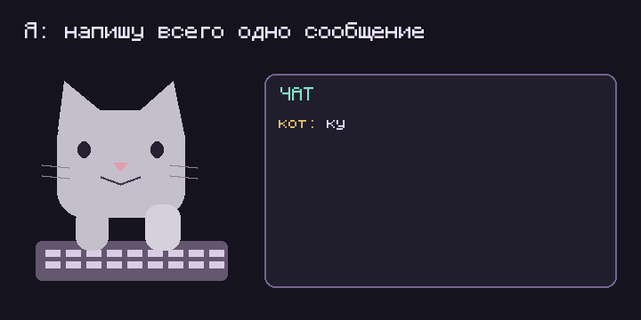

<div align="center">
  
  <h1>Chatiffy</h1>
  <p>Twitch-чат для OBS с предпросмотром, настройками оформления и 7TV.</p>
</div>

<p align="center">
  
</p>

> Проект создан с помощью ИИ. Возможны ошибки: проверяйте новую версию перед использованием на стриме.

Chatiffy работает как приложение Windows в системном трее. Вы выбираете канал,
настраиваете вид чата и один раз вставляете ссылку в OBS. Дальнейшие изменения
сохраняются автоматически и появляются в источнике примерно через 3 секунды.

**Стабильная версия — 1.5.1: Setup и portable.** Windows-сборки опубликованных
версий находятся в GitHub Releases. Тестовые сборки из `beta` доступны через GitHub Actions.

Версия 1.4.5 объединяет серию 1.4.2 и промежуточные выпуски 1.4.3–1.4.4.
Их Git-теги сохранены; актуальный архив доступен в общем выпуске.

## Возможности

- По умолчанию открыт демо-чат для настройки оформления. В предпросмотре можно переключиться на сообщения выбранного Twitch-канала без входа в аккаунт. Демо использует пародийные ники и публичные бейджи оригинальных аккаунтов.
- Живой демо-чат: 256 реплик с пародийными никами, упоминаниями и анимированным 7TV kekBomb; новые строки вытесняют старые по выбранному лимиту, доступна пауза.
- Готовые стили: пиксельный, минимализм, стекло, неон и прозрачный.
- Шрифт, размер, жирность, курсив, интервалы и цвет текста.
- Настройки фона, расположения, количества и времени показа сообщений.
- Twitch-эмоуты, глобальные и канальные 7TV-эмоуты, полный каталог глобальных и канальных Twitch-бейджей (включая Пичу и Invincible VS), бейджи и косметика 7TV.
- Постоянные ссылки OBS, автосохранение и сброс оформления с сохранением канала.
- Именованные профили сцен: переключение, создание новой сцены и копирование оформления.
- Экспорт и импорт профилей в JSON для резервной копии и переноса.
- Размеры источника: обычный 600 × 900 и вертикальный 540 × 960.
- Проверка обновлений, установка новой стабильной Windows-версии и диагностика сервера.
- Переключатель «Запускать вместе с Windows» в меню трея.

## Скачать и запустить на Windows

Нужна **Windows 10/11 x64 с .NET Framework 4.8**. Node.js входит в архив;
отдельная установка Node.js или Docker не требуется.

### Стабильная версия

1. Откройте [GitHub Releases](https://github.com/MimiClous/chatiffy/releases).
2. Скачайте `Chatiffy-<версия>-windows-x64-Setup.exe` для установки или `Chatiffy-<версия>-windows-x64.zip` для portable.
3. Запустите Setup. Для portable распакуйте **весь архив** в папку, доступную для записи, и запустите `Chatiffy.exe`.
4. Дважды нажмите значок в трее. Редактор открывается на `http://127.0.0.1:17845`.

При обновлении с **1.3.1** учитывайте смену порта с 8080 на 17845.
Приложение не подписано цифровой подписью.

### Тестовая версия для разработчика

1. Откройте [Test Windows build в GitHub Actions](https://github.com/MimiClous/chatiffy/actions/workflows/beta.yml).
2. Выберите **успешный** запуск нужного коммита ветки `beta`.
3. В разделе **Artifacts** скачайте `Chatiffy-<версия>-windows-x64`.
4. Распакуйте архив артефакта, затем вложенный ZIP приложения целиком.
5. Завершите обычный Chatiffy через трей и запустите тестовый `Chatiffy.exe`.

Для скачивания артефактов может потребоваться вход в GitHub. Артефакты хранятся 14 дней.
Тестовая версия имеет номер `1.5.1-beta.<номер запуска>.g<хеш коммита>` и не публикуется как стабильный
релиз. Она использует ту же папку пользовательских данных и порт, поэтому перед
проверкой миграций сделайте резервную копию `%LOCALAPPDATA%\Chatiffy`.

## Добавить чат в OBS

1. Откройте `http://127.0.0.1:17845` в браузере или пользовательской док-панели OBS.
2. Введите Twitch-логин канала и выберите готовый стиль.
3. Подстройте оформление по предпросмотру и дождитесь статуса «Сохранено».
4. Нажмите **«Скопировать ссылку для OBS»**.
5. В OBS добавьте источник **«Браузер»**, вставьте ссылку и задайте размер **600 × 900**.

Кнопка применения не нужна. Если сервер не смог сохранить настройки, редактор покажет
ошибку и кнопку повтора; несохранённая ссылка не копируется.

Редактор `/` показывает тестовые сообщения. Настоящий Twitch-чат запускается только
на странице `/overlay`. По умолчанию показываются 9 сообщений без исчезновения по таймеру.

### Постоянная ссылка

Новые ссылки имеют вид:

```text
http://127.0.0.1:17845/overlay?profile=<идентификатор профиля>
```

Источник OBS получает настройки с локального сервера. Чтобы изменить существующий
профиль, откройте его ссылку, заменив `/overlay` на `/`. Повторно вставлять ссылку в OBS
не требуется. При обычном открытии редактор вспоминает последний профиль этого браузера.

Храните ссылку приватно: идентификатор даёт доступ к профилю. Профили находятся в
`%LOCALAPPDATA%\Chatiffy\profiles`, а не внутри папки установленного приложения.

### Несколько сцен OBS

В верхней части редактора выберите профиль в списке «Сцена OBS». Дайте ему понятное
название: например, «Общение», «Игра» или «Вертикальный стрим». Имя сохраняется автоматически
и не меняет уже вставленную ссылку.

- **«+ Новая сцена»** создаёт отдельный профиль с текущим каналом и стандартным оформлением.
- **«Скопировать профиль»** создаёт независимую копию выбранного оформления и канала.
- При переключении редактор сначала сохраняет текущую сцену. Если сохранить не удалось,
  переход отменяется, чтобы изменения не потерялись.

После создания профиля скопируйте его ссылку в отдельный источник OBS. Переключение
профиля в редакторе не переключает источники в OBS: каждый продолжает показывать свой чат.
Профили хранятся на сервере и доступны в другом браузере на этом же сервере.

В разделе «Перенести или сохранить профиль» экспортируйте выбранную сцену в JSON.
На другом компьютере импортируйте этот файл: появится новая сцена со своей ссылкой.
Существующие профили не заменяются. В файле нет Twitch API-ключей и исходной OBS-ссылки.

Над предпросмотром выберите размер источника: обычный **600 × 900** или вертикальный
**540 × 960**. Редактор покажет нужные пропорции и размеры для OBS. Сам размер Browser
Source задайте вручную в OBS — приложение не управляет настройками OBS напрямую.
Для вертикального источника предпросмотр сохраняет точные пропорции. Переключатель
масштаба позволяет вписать весь чат или показать текст в размере **100%**, с прокруткой.

**При переходе со старого порта 8080 на 17845 один раз замените адрес источника OBS.**
Старые ссылки с `instance` и параметрами оформления продолжают работать как статические.
Откройте такую ссылку в редакторе и скопируйте новую, чтобы перейти на постоянный профиль.

## Нужен ли Twitch-аккаунт или бот?

**Нет.** Сообщения читаются через анонимное подключение к Twitch IRC WebSocket со
случайным именем `justinfan…`. Приложение не входит в ваш аккаунт, не использует
бот-аккаунт и не отправляет сообщения от вашего имени.

Необязательные `TWITCH_CLIENT_ID` и `TWITCH_CLIENT_SECRET` нужны серверу для получения
ID каналов и полного каталога Twitch-бейджей. Это ключи приложения; они не нужны для
чтения чата. Без них используются резервное определение ID и встроенный набор бейджей.
Сбой дополнительных ресурсов не останавливает уже подключённый IRC-чат.

## Шрифты

Доступны Monocraft, Segoe UI, Arial, Verdana, Georgia и Consolas. Monocraft с кириллицей
включён в приложение вместе с обычным и жирным начертаниями и лицензией SIL OFL 1.1.
Остальные семейства берутся из системы на компьютере с OBS; при их отсутствии используется
резервный шрифт. На macOS внешний вид системных шрифтов может отличаться от Windows.

## Меню трея и обновления

В трее доступны редактор, диагностика, проверка обновлений и выход. В разделе
**«Дополнительно»** находятся настройки Twitch, журнал и перезапуск сервера.
Закрытие браузера не останавливает приложение; выход из трея останавливает сервер.
Для завершения из командной строки: `Chatiffy.exe --quit`.

Для обновления откройте **«Приложение и обновления» → «Проверить обновления»**.
При наличии новой стабильной версии Windows-приложение предложит
**«Обновиться и перезапустить»**. Установщик скачивает официальный ZIP, проверяет SHA-256,
создаёт резервную копию и заменяет файлы. Пользовательские настройки сохраняются.
Папка установки и её родитель должны быть доступны для записи.

Старую версию без этой функции обновляйте вручную: завершите приложение и распакуйте
полный новый архив. В тестовых сборках установка стабильных обновлений кнопкой отключена.
Подробности и ограничения: [обновления и тестовые сборки](docs/UPDATES-AND-TESTING.md).

## Если что-то не работает

| Проблема | Что проверить |
| --- | --- |
| Редактор не открывается | Запущен ли Chatiffy; свободен ли порт **17845**; что показывает диагностика и журнал |
| Не виден значок приложения | Откройте скрытые значки Windows в трее |
| Изменения не появляются в OBS | Используется ли новая ссылка с `profile`; доступен ли локальный сервер; есть ли статус «Сохранено» |
| Нет части бейджей или эмоутов | Доступность Twitch/7TV; для полного каталога Twitch-бейджей нужны необязательные API-ключи |
| Не найдено обновление | Опубликован ли более новый стабильный релиз с Windows ZIP и SHA-256; доступен ли GitHub |

Ключи Twitch хранятся в `%LOCALAPPDATA%\Chatiffy\settings.env`. После изменения нужен
перезапуск сервера через «Дополнительно». Не публикуйте этот файл. Журнал `server.log`
находится рядом. Автозапуск не включается автоматически; при необходимости добавьте
ярлык приложения в папку `shell:startup`.

## Разработка

Клиент и сервер написаны на **TypeScript со строгой проверкой типов**. Windows-лаунчер —
C# / WinForms. HTML/CSS отвечают за интерфейс. Runtime npm-зависимостей нет;
TypeScript, esbuild и типы Node.js нужны только для разработки и сборки.

Нужны Node.js 22+ и pnpm версии, указанной в `package.json`.

```sh
git clone git@github.com:MimiClous/chatiffy.git
cd chatiffy
git switch beta
pnpm install --frozen-lockfile
pnpm run check
pnpm test
```

`pnpm test` сначала собирает проект. Для запуска без тестов выполните `pnpm run build`.

Linux/macOS:

```sh
HOST=127.0.0.1 ALLOWED_HOSTS=127.0.0.1,localhost pnpm start
```

Windows PowerShell:

```powershell
$env:HOST = '127.0.0.1'
$env:ALLOWED_HOSTS = '127.0.0.1,localhost'
pnpm start
```

Откройте `http://127.0.0.1:17845`. При пустом `ALLOWED_HOSTS` сервер возвращает 403.
Без лаунчера данные по умолчанию хранятся в `~/.chatiffy`; путь можно переопределить
переменной `CHATIFFY_DATA_DIR`. После изменения TypeScript повторите сборку и перезапустите сервер.

### Сборка Windows

Нужны Windows, компилятор .NET Framework и официальная распакованная дистрибуция
Node.js 24 LTS x64 с `LICENSE` рядом с `node.exe`.

```powershell
powershell -NoProfile -ExecutionPolicy Bypass -File scripts/build-windows.ps1 -NodePath C:\node\node.exe
powershell -NoProfile -ExecutionPolicy Bypass -File scripts/test-windows.ps1
powershell -NoProfile -ExecutionPolicy Bypass -File scripts/test-updater.ps1
powershell -NoProfile -ExecutionPolicy Bypass -File scripts/build-setup.ps1
powershell -NoProfile -ExecutionPolicy Bypass -File scripts/test-setup.ps1
```

Перед сборкой установите зависимости и выполните проверки выше. Для Setup нужен Inno Setup 6. Результат — ZIP, Setup.exe и
SHA-256 в `dist/`. Проверки Windows требуют закрытого Chatiffy и свободного порта 17845.
На macOS можно проверять клиент и сервер; нативный WinForms-лаунчер проверяется на Windows.

Workflow `beta.yml` запускается при push в `beta`; стабильный релиз выпускается workflow
`windows-release.yml` по тегу `v<версия package.json>` после успешных проверок.
Ручной запуск workflow через GitHub доступен, когда workflow зарегистрирован в основной
ветке репозитория; для первого запуска тестовой ветки достаточно push в `beta`.

## Docker Compose

Для серверного запуска вместо Windows-лаунчера:

```sh
cp .env.example .env
```

Для локального использования задайте в `.env`:

```dotenv
TWITCH_CLIENT_ID=
TWITCH_CLIENT_SECRET=
ALLOWED_HOSTS=127.0.0.1,localhost
APP_PORT=17845
```

```sh
docker compose up -d --build
curl http://127.0.0.1:17845/api/health
```

Ожидается `"ok":true`; `twitchConfigured` зависит от наличия ключей. Compose публикует
порт только на loopback. Для другого способа доступа отдельно настройте сеть и разрешённые
хосты. Профили хранятся в постоянном volume `profiles` в `/data/profiles`.
Не удаляйте этот volume, если хотите сохранить настройки и работу постоянных ссылок.

Обновление Docker-установки:

```sh
git pull
docker compose up -d --build
```

Секреты исключены из Git и build context. Runtime-контейнер работает от пользователя
`node`, с read-only корневой файловой системой и отдельным записываемым volume данных.

## Версии и наименования

Стабильный выпуск: `1.5.1`, тег `v1.5.1`, архив `Chatiffy-1.5.1-windows-x64.zip` и установщик `Chatiffy-1.5.1-windows-x64-Setup.exe`.
Бета: `1.5.1-beta.42.gabcdef0` — номер запуска и короткий Git SHA формируются автоматически.
MAJOR означает несовместимое изменение, MINOR — новую возможность, PATCH — исправление.
[Политика версий и порядок выпуска](docs/VERSIONING.md).

## Документация и структура

| Путь | Содержание |
| --- | --- |
| [`docs/ARCHITECTURE.md`](docs/ARCHITECTURE.md) | Архитектура и границы модулей |
| [`docs/SPECIFICATION.md`](docs/SPECIFICATION.md) | Поведение, параметры ссылок, API и хранение данных |
| [`docs/EXTENDING.md`](docs/EXTENDING.md) | Добавление настроек, шрифтов, тем и провайдеров |
| [`docs/DEVELOPMENT.md`](docs/DEVELOPMENT.md) | Разработка, тестирование и сборка |
| [`docs/UPDATES-AND-TESTING.md`](docs/UPDATES-AND-TESTING.md) | Windows-обновления и тестовые сборки |
| `src/client/` | Редактор, рендер сообщений, IRC и провайдеры эмоутов |
| `src/shared/` | Общие контракты, схема настроек и версия |
| `src/server/` | HTTP/API, профили, кеш и проверка релизов |
| `windows/` | WinForms-лаунчер и PowerShell-установщик обновлений |
| `scripts/` | Сборка, генерация иконок и Windows-проверки |
| `tests/`, `test.mjs`, `typography.test.mjs` | Проверки модулей, HTTP и поведения клиента |

`build/` генерируется автоматически и не коммитится. Редактируйте TypeScript в `src/`,
а не собранный JavaScript. Корневой `server.mjs` остаётся точкой запуска для лаунчера.

## Автозагрузка Windows

В меню значка Chatiffy в трее включите **«Запускать вместе с Windows»** (с 1.4.5).
Приложение запустится в фоне при входе в вашу учётную запись, браузер не откроется.
Снять галочку можно там же. Права администратора не нужны; обновление в той же папке
сохраняет этот выбор. При переносе приложения запустите его из новой папки, чтобы
обновить путь. Перед удалением выключите автозагрузку. Если ранее создавали ярлык
через shell:startup, удалите его отдельно, чтобы не было двух записей.

### Обновление с 1.4.0–1.4.3 при Invalid release checksum file

В старом скрипте обновления есть ошибка чтения бинарного ответа .sha256 в Windows
PowerShell. Исправление включено в 1.4.5; старой установке потребуется один ручной
переход: завершите Chatiffy через трей и установите актуальный Setup или распакуйте полный ZIP нового выпуска в папку
приложения с заменой файлов. Профили в %LOCALAPPDATA%\Chatiffy сохранятся.
Проверка SHA-256 в новом обновляторе остаётся обязательной.

## Setup и portable (с 1.5.0)

- **Setup.exe** устанавливает приложение для текущего пользователя в `%LOCALAPPDATA%\Programs\Chatiffy`, добавляет ярлык в меню «Пуск» и удаление через настройки Windows. Права администратора не нужны.
- **windows-x64.zip** — portable: распакуйте весь архив в постоянную папку и запустите Chatiffy.exe.

Оба варианта обновляются кнопкой в приложении через один проверенный ZIP с SHA-256.
Установщик сам по себе не заменяет проверку обновлений. При обновлении Setup-версии
сохраняются удаление через Windows, ярлыки и автозагрузка. Профили обоих вариантов
находятся в `%LOCALAPPDATA%\Chatiffy`; удаление Setup оставляет их для повторной установки.
Перед ручной установкой поверх работающего приложения выйдите через трей.
Для перехода с portable установите Setup и запускайте новую копию. Если автозагрузка
включена, первый запуск обновит её путь. Не запускайте обе копии одновременно.

## Меню разработчика

Требуются Node.js 20+ и pnpm. На macOS откройте `dev.command`, на Windows — `dev.cmd`. Из терминала: `pnpm dev:menu`.

Меню устанавливает зависимости, запускает приложение на localhost, выполняет проверки, собирает Windows-пакеты и выпускает релиз через GitHub Actions. Локальная сборка Setup требует Windows, .NET Framework и Inno Setup 6. На Mac используйте выпуск через GitHub Actions.

Для выпуска: смените номер версии пунктом 6, обновите README и `windows/RELEASE.md`, проверьте и закоммитьте изменения, затем выберите пункт 7. Нужны доступ на push и настроенный Git. Меню запускает проверки и публикует main, beta и тег одной атомарной отправкой; готовый релиз создаёт CI. При ошибке сборки смотрите ссылку Actions, которую выводит меню. Существующие теги не перезаписываются.
